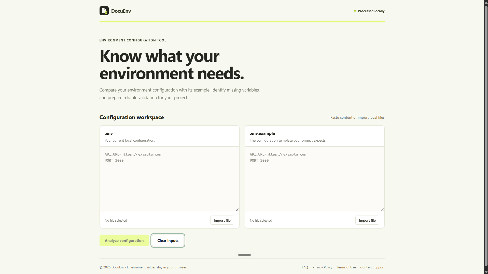
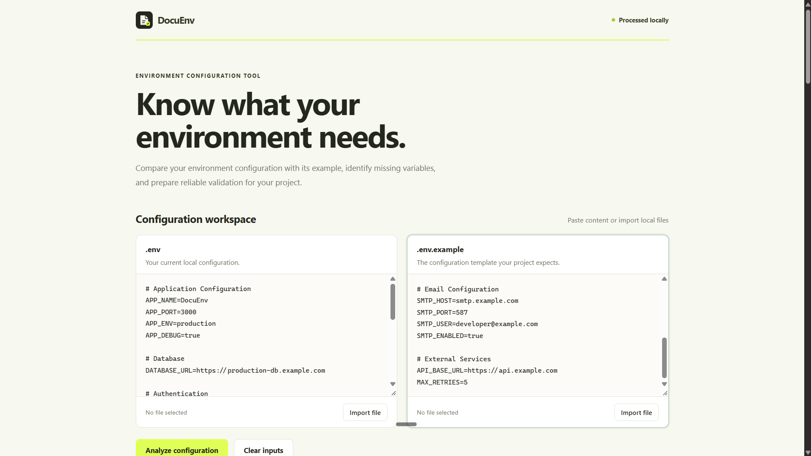
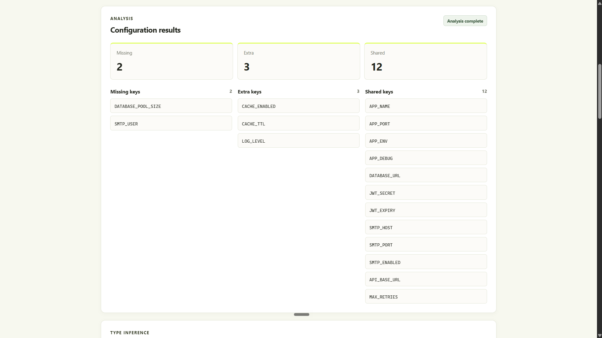
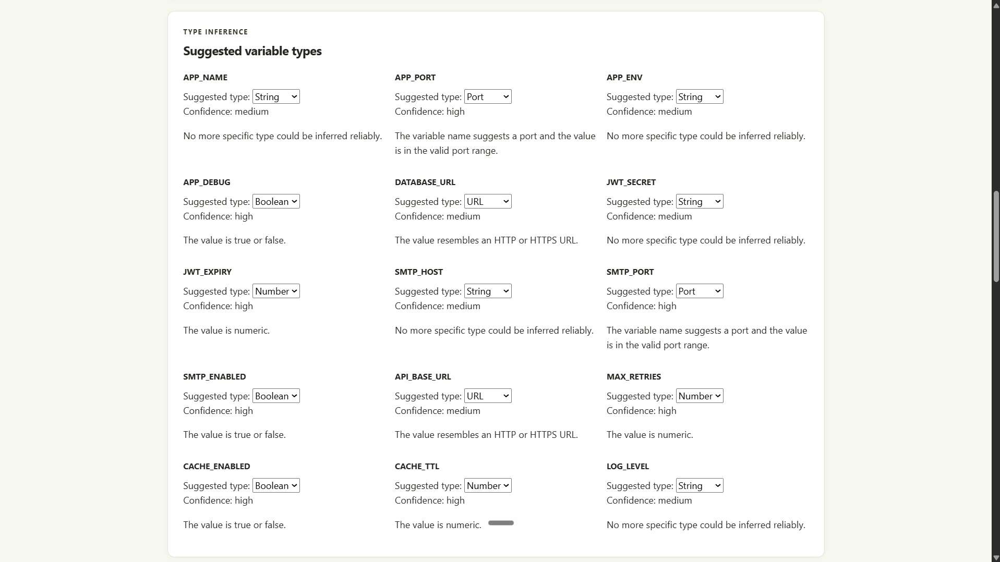
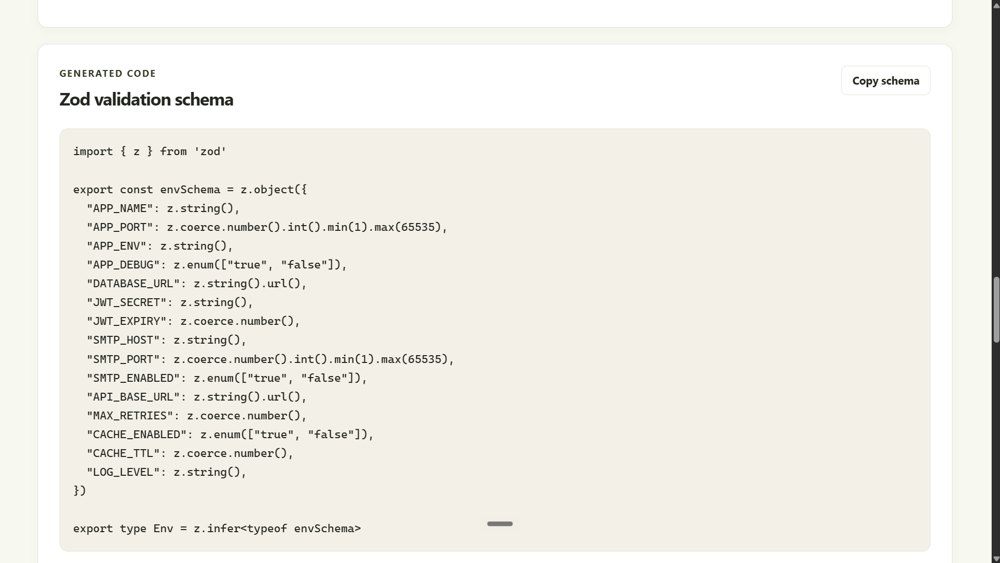
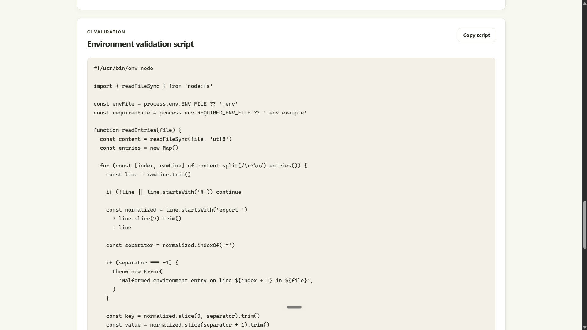
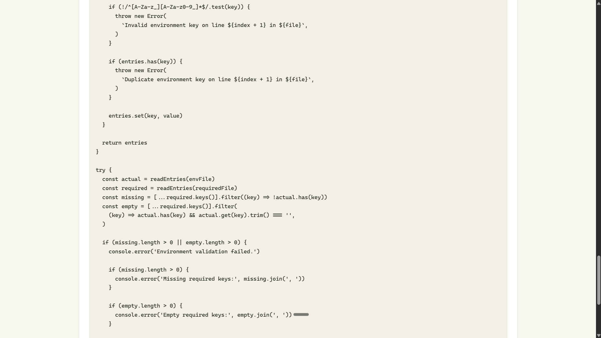
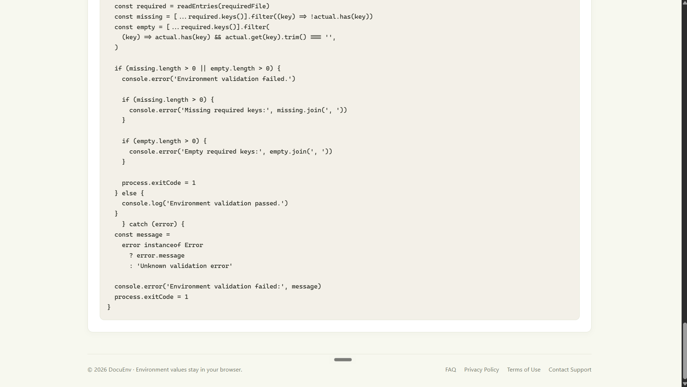

# DocuEnv

**Audit environment configuration drift. Generate validation contracts. Keep your configuration local.**

DocuEnv is a privacy-first developer utility that compares environment-variable configurations, identifies missing and extra keys, suggests likely value types, and generates Zod schemas and CI validation scripts.

[**Live Demo →**](https://docuenv.pages.dev) · [**GitHub Repository**](https://github.com/shriram-io/DocuEnv) · [**Latest Release: v1.1.0**](https://github.com/shriram-io/DocuEnv/releases/tag/v1.1.0)

---
## Application Preview

### Homepage


### Configuration Analysis




### Type Inference


### Generated Zod Schema


### CI Validation






---
## Features

- **Local file import and paste:** Load `.env` and `.env.example` files directly in your browser.
- **Configuration comparison:** Identify missing, extra, and present environment variables.
- **Parsing diagnostics:** Review supported syntax issues and environment-variable warnings.
- **Type inference:** Get heuristic suggestions for strings, integers, booleans, URLs, emails, and ports.
- **Manual overrides:** Adjust inferred types and requiredness.
- **Zod schema generation:** Generate TypeScript validation schemas.
- **CI validation:** Generate scripts that check required environment-variable presence.
- **Copy and export:** Copy generated output and use the available download functionality.
- **Privacy-first processing:** Analyze configuration locally in your browser without requiring an application backend.

## Getting Started

### Requirements

- Node.js
- npm
- Git (optional)

### Installation

```bash
git clone https://github.com/shriram-io/DocuEnv.git
cd DocuEnv
npm install
```

### Run Locally

```bash
npm run dev
```

Open the local URL printed by Vite in your browser.

### Verify the Project

Run the following commands:

```bash
npm run test
npm run lint
npm run build
```

## How to Use

1. Open [DocuEnv](https://docuenv.pages.dev).
2. Paste or import your reference configuration, such as `.env.example`.
3. Paste or import the configuration you want to audit.
4. Run the comparison.
5. Review missing, extra, and present variables.
6. Inspect parsing diagnostics and warnings.
7. Review inferred types and adjust them when necessary.
8. Generate your Zod schema or CI validation script.
9. Copy or download the generated output using the available controls.

## Privacy and Security

DocuEnv is designed to process environment-file contents locally in your browser. Its core functionality does not require an application backend to receive configuration values.

Local processing is not an absolute security guarantee. Your browser, extensions, device, and application bundle still need to be trustworthy.

Security recommendations:

- Never commit real `.env` files or credentials.
- Keep example files limited to placeholder values.
- Review generated code before using it in production.
- Do not treat inferred types as guaranteed validation rules.
- Avoid sharing production secrets in bug reports or support requests.

## Supported Syntax and Limitations

DocuEnv supports common `.env` assignment syntax, comments, and quoted values, with diagnostics for supported parsing errors and edge cases.

It is not intended to implement every dotenv dialect, shell expansion rule, interpolation convention, or deployment-platform-specific behavior.

Type inference is advisory and should be reviewed by the user.

The generated CI script checks required key presence. It is not a secret scanner or a complete deployment validation system.

## Technology Stack

| Technology | Purpose |
|---|---|
| React | User interface |
| TypeScript | Type safety |
| Vite | Development and production build |
| Vitest | Automated testing |
| ESLint | Code quality |

## Project Documentation

The `docs/` directory contains the project's documentation:

| Document | Description |
|---|---|
| `01_PRD_DocuEnv.docx` | Product Requirements Document |
| `02_SRS_DocuEnv.docx` | Software Requirements Specification |
| `03_Architecture_DocuEnv.docx` | Architecture Document |
| `04_UI_UX_DocuEnv.docx` | UI/UX Specification |
| `05_Development_DocuEnv.docx` | Development Plan |
| `rules.md` | Project Rules |

## Support and Legal Information

- **FAQ:** Available through the application's FAQ page.
- **Privacy Policy:** Explains the application's data-processing approach.
- **Terms of Use:** Describes usage conditions and limitations.
- **Support:** shriram.project1@gmail.com

Please do not include passwords, API keys, or production secrets in support requests.

## Development Guidelines

Before submitting changes:

1. Run the automated test suite.
2. Run ESLint.
3. Verify the production build.
4. Manually test affected functionality.
5. Check responsive layouts.
6. Review privacy-related network behavior when changing data-processing functionality.

## License

This project is licensed under the **MIT License**. See the [LICENSE](LICENSE) file for details.

---

**DocuEnv v1.1.0** · Built for developers who want safer and more reliable environment configuration management.